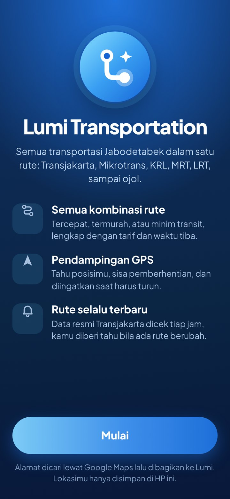
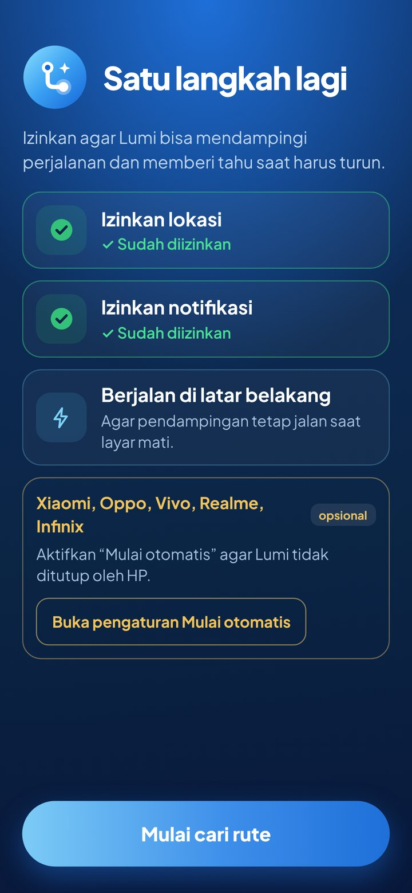
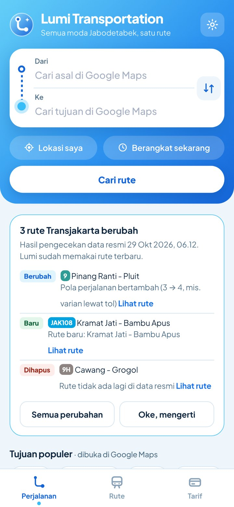
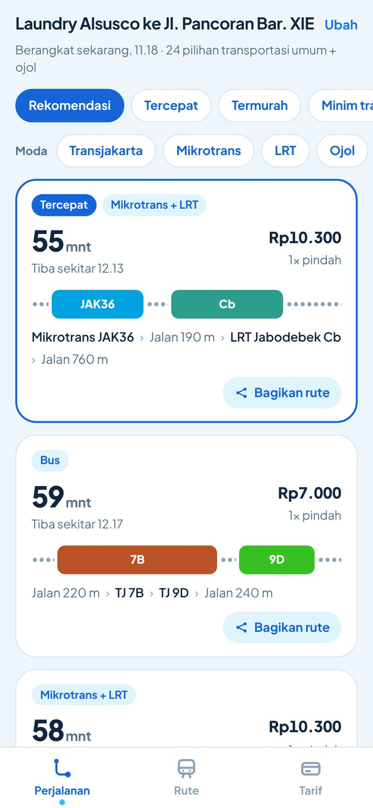
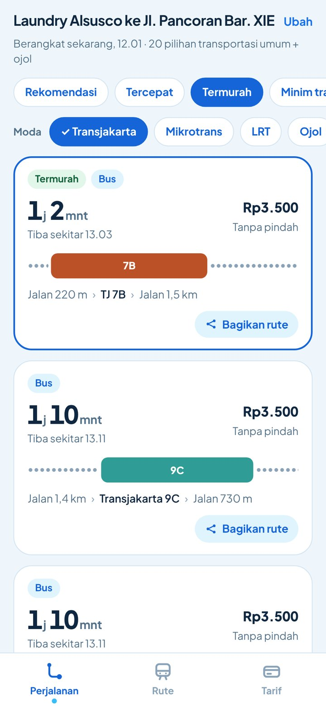
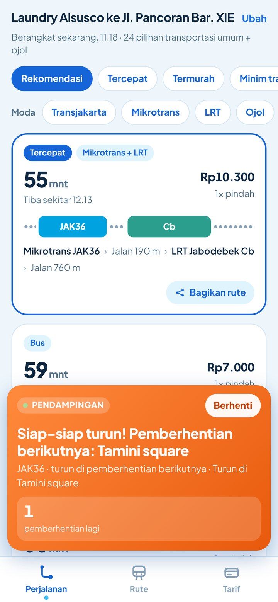
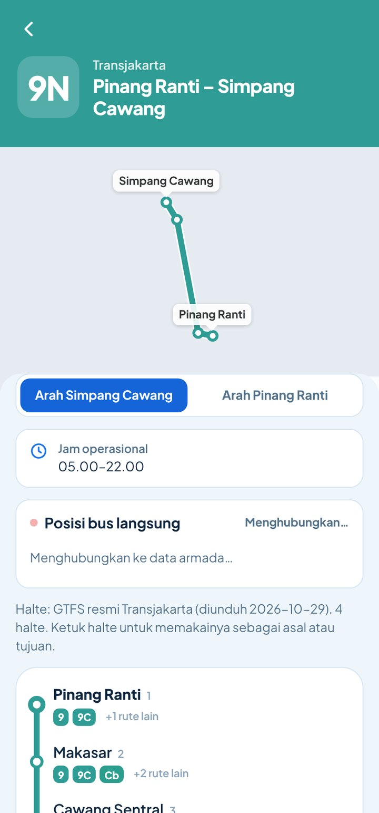
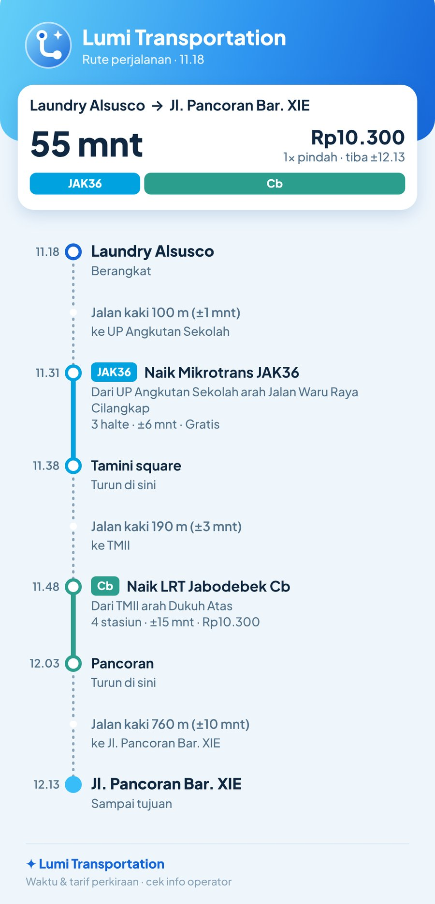
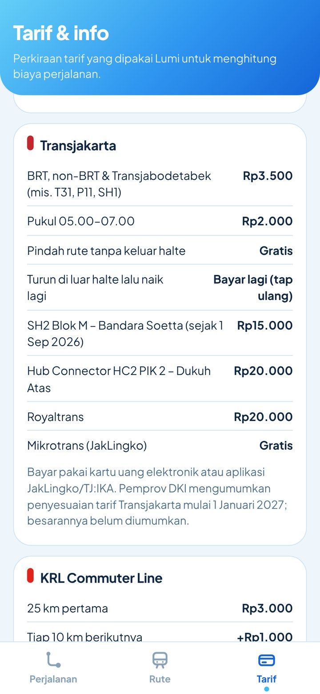

<div align="center">


# ✦ Lumi Transportation ✦

### An all-modes journey planner for Greater Jakarta, on Android

*Transjakarta · Mikrotrans · KRL · MRT · LRT · Airport Rail · Whoosh · ride-hailing, in one route*

[](https://github.com/vickyvam72/LumiTransportation/releases/latest)
[](#-requirements)
[](#%EF%B8%8F-tech-stack)
[](LICENSE)
[](#-why-lumi-transportation)

**🌐 Bahasa / Language:** &nbsp; [🇮🇩 Bahasa Indonesia](README.md) &nbsp;|&nbsp; **🇬🇧 English**

[⬇️ Download](#%EF%B8%8F-download--install) · [📸 Screenshots](#-screenshots) · [✨ Features](#-features) · [💸 Fares](#-fares-used) · [📖 User Guide](#-user-guide) · [❓ FAQ](#-faq--troubleshooting) · [📝 Changelog](CHANGELOG.md)

</div>

---

## 🌟 Why Lumi Transportation?

> Enter an **origin** and a **destination**, and Lumi works out **every sensible public-transport combination** (bus, minibus, train, even ride-hailing) with **travel time, fare, and where to get off**. Once you're on your way, Lumi **guides you with GPS** and tells you when to get off.

| | |
|---|---|
| 🗺️ **Every route combination** | Routes 9 and 9A appear as separate options, and so do JAK36 → LRT, 9C → Makasar → JAK108 and more. Not just one answer. |
| 🎯 **Filters you control** | Sort by Fastest, Cheapest or Fewest transfers, then pick modes: only trips that **include TJ**, or TJ + LRT, and so on. |
| 🚌 **Bus positions in the TJ app** | Every Transjakarta, Mikrotrans and Royaltrans leg has a **See bus position in the TJ app** button that opens the official TJ app, or the Play Store if it isn't installed. |
| 🧭 **GPS guidance** | See where you are, **how many stops are left**, and feel a vibration for **"Get ready"** and **"Get off now"**, even with the screen off. |
| 🔔 **Know when routes change** | Official Transjakarta data is **checked every hour**. New routes, removed routes or changed stops trigger a **notification**. |
| 🖼️ **Share as an image** | Every route can be shared as a **clean image** to WhatsApp, Instagram or anywhere. |
| 💸 **Correct fares** | Transferring inside a station is free; leaving the station means tapping in again. Covers SH2, Hub Connector, MRT per-station fares and Airport Rail. |
| 🌙 **Knows opening hours** | At midnight Lumi only uses 24-hour services (AMARI corridors 1–14, JAK36/47/52/75) and ride-hailing. |
| 📍 **Addresses from Google Maps** | Find a place in Google Maps, tap **Share → Lumi**. The place's coordinates are read automatically. |
| 🪶 **Tiny and offline** | About **350 KB**. Route planning runs **on your phone**, with no server. |

---

## 📸 Screenshots

<div align="center">

| 👋 Welcome | ✅ One more step | 🏠 Home |
|:-:|:-:|:-:|
|  |  |  |
| **Get to know Lumi on one screen**, no scrolling. | **Only the permissions that matter**: location, notifications, background running, plus an "Auto-start" shortcut for Xiaomi, Oppo, Vivo, Realme and Infinix. | **Route changes up front**: new, removed or changed routes, one tap away. |

| 🗺️ All options | 🎯 Mode & sort filters | 🧭 GPS guidance |
|:-:|:-:|:-:|
|  |  |  |
| **Compare at a glance**: colour strip per line, time, fare, transfers and a **Share route** button on every card. | **Only trips with TJ, cheapest first.** Or TJ + LRT, Mikrotrans, KRL, MRT, ride-hailing. | **Never miss your stop**: "Get ready!" one stop before, with vibration. |

| 🧭 Clear directions & variants |
|:-:|
|  |
| **9N: Pinang Ranti – Simpang Cawang**, two clear directions, and every variant described (via toll, via Senen, …). |

| 🖼️ Share as image | 💸 Up-to-date fares |
|:-:|:-:|
|  |  |
| **Send a route to friends or family** as an image: boarding times, direction, where to get off, fare per leg. | **Fares as of October 2026**, including SH2 Rp15,000 and Hub Connector Rp20,000. |

</div>

---

## ✨ Features

**🗺️ Journey planner**
- **Offline** routing engine (graph + Dijkstra) plus a systematic search of **every direct route and every two-route combination**, so options like 9/9C → Makasar → JAK36/JAK108 and LRT → TMII → JAK36 show up
- **Same-code variants** kept apart, e.g. corridor 9 towards Pluit **via the toll road**, skipping Kemanggisan to Jembatan Dua
- Loop routes (e.g. JAK36 Cilangkap → Cililitan → Cilangkap) handled correctly: board and alight on the right side of the road, and **don't ride the loop** just to walk a bit less
- Duplicate options and pointless "ride one stop, then walk" options are removed
- **Depart at / arrive by**, using each mode's operating hours
- **Ride-hailing + train** combinations and direct motorbike/car ride-hailing, with road distance from OSRM

**🚌 Bus positions**
- Transjakarta's fleet server only serves its official app, so Lumi doesn't show bus positions itself. Each bus leg has a **See bus position in the TJ app** button that opens the TJ app, or the Play Store if it isn't installed

**🧭 GPS guidance**
- The map shows only what's left of the trip: passed lines and stops disappear; the first walk starts from where you are now
- Walking is shown as blue dots along real streets (foot routing from [routing.openstreetmap.de](https://routing.openstreetmap.de) and road routing from [OSRM](https://project-osrm.org), whichever fits best)
- **Picture-in-picture**: a small live map plus instructions stay visible while you use other apps; closing the window closes the app
- **Compass beam**: your location dot shows which way your phone is facing
- A prompt to turn on GPS when phone location is off

**🎯 Result filters**
- Sort: **Recommended · Fastest · Cheapest · Fewest transfers**
- Modes: **Transjakarta · Mikrotrans · LRT · MRT · KRL · Royaltrans · Airport Rail · Whoosh · Ride-hailing**. Shown trips **include every selected mode** and may combine others

**🧭 Guidance mode**
- Tap **Start guidance** on a trip
- GPS runs in a **foreground service**, so it keeps working with the screen off or the app in the background
- Live notification: *"JAK36 · 2 stops left · get off at UP Angkutan Sekolah"*
- Vibrating alerts: **Get ready** (one stop left) and **Get off now** (with the next connection)
- Your position on the trip map, and the current step marked **"You are here"**

**🔔 Always-current routes**
- On first launch Lumi downloads the **official Transjakarta GTFS** and processes it on the phone
- **Every hour** (in the background, very little data) Lumi checks:
  1. the route-change feed in this repo (`data/route_changes.json`), updated hourly by GitHub Actions, and
  2. the version signature of the official GTFS file (ETag / Last-Modified / size)
- When something changes, route data is re-downloaded, differences are computed (new or removed routes, stops added/removed, variant patterns changed) and a **notification** appears
- History is shown on Home and in **Settings → Route changes**

**🖼️ Share routes as images**
- **Share route** button on every result card and on the trip screen
- PNG with origin → destination, total time and fare, a mode strip, and step-by-step boarding times, directions, stops and fares

**📍 Addresses via Google Maps**
- Tap From/To → **Search in Google Maps** → pick the place → **Share → Lumi Transportation**
- The **place** coordinates are read from the link (not the map view), using three methods in parallel, and cached for instant reuse
- **Saved places**, **My location**, and pick-on-map

**🎨 Look & feel**
- **Light-blue** theme with a blue-gradient logo; welcome and permission screens that **fit on one screen**
- Full route info: search routes (`9`, `13C`, `JAK.10`, `Bogor`, `MRT`), stop order, directions, variants, operating hours, and connections at each stop
- **OpenFreeMap** vector maps (MapLibre GL) — free, no API key; Liberty, Bright, Positron or standard OpenStreetMap styles

---

## 💸 Fares used

Updated **29 October 2026**. Fares are estimates; always check the operator's announcements.

| Mode | Fare |
|---|---|
| Transjakarta BRT, non-BRT, Transjabodetabek (T31, P11, SH1, …) | **Rp3,500** (Rp2,000 from 05:00–07:00) |
| Transfer without leaving the station | Free |
| Leave at a roadside stop, then board again | Pay again (tap in again) |
| SH2 Blok M – Soekarno-Hatta Airport (since 1 Sep 2026) | Rp15,000 |
| Hub Connector HC2 PIK 2 – Dukuh Atas | Rp20,000 |
| Royaltrans | Rp20,000 |
| Mikrotrans (JakLingko) | Free |
| KRL Commuter Line | Rp3,000 (first 25 km) + Rp1,000 per 10 km |
| MRT Jakarta | Rp3,000 + Rp1,000 per station, max Rp14,000 |
| LRT Jakarta (incl. Velodrome – Manggarai) | Rp5,000 flat |
| LRT Jabodebek, peak (Mon–Fri 06:00–08:59 & 16:00–19:59) | Rp5,000 + Rp700/km, max Rp20,000 |
| LRT Jabodebek, off-peak, weekends & holidays | max Rp10,000 |
| Airport Rail from Manggarai / BNI City / Duri | Rp70,000 (Rawa Buaya / Batu Ceper Rp35,000) |
| Whoosh | from Rp250,000 (dynamic pricing) |
| Motorbike ride-hailing (Greater Jakarta zone) | Rp2,550–2,800/km, minimum Rp10,200–11,200 + app fee |

> ℹ️ The Jakarta government has announced a **Transjakarta fare adjustment from 1 January 2027**; the amount hasn't been published yet. A new LRT Jakarta fare is also expected soon.

Sources are listed in the [Indonesian README](README.md#-tarif-yang-dipakai).

---

## ⬇️ Download & Install

1. Open the **[Releases](https://github.com/vickyvam72/LumiTransportation/releases/latest)** page.
2. Under **Assets**, download `LumiTransportation-v2.3.apk`.
3. Open the downloaded file. If Android asks, allow **"Install unknown apps"** for your browser or file manager.
4. Tap **Install**. Done! 🎉

> 💡 **Updating:** just install the new APK over the old one. Saved places and settings are kept.

### 📋 Requirements
- Android **7.0 (API 24)** or newer
- About **10 MB** of free space (official route data is stored on the phone)
- Internet for maps, reading Google Maps links and checking route changes (route planning itself is offline)
- The **Google Maps** app for address search (recommended)

---

## 📖 User Guide

### 0️⃣ First launch
Two short screens, each **fitting on one screen without scrolling**:
1. **Welcome**: a feature overview, tap **Mulai** (Start).
2. **One more step**: allow **location**, **notifications** and **background running**. Xiaomi, Oppo, Vivo, Realme and Infinix phones get an optional **Auto-start settings** button.

Lumi then downloads the official Transjakarta route data in the background (needs internet once).

### 1️⃣ Set origin & destination
Tap **Dari** (From) or **Ke** (To) → **Cari di Google Maps** → pick the place → **Share** → **Lumi Transportation**. The field fills in automatically and the place is saved. You can also use **My location** or a saved place.

### 2️⃣ Pick a time & search
Tap the time chip for **Depart at** or **Arrive by**, then **Cari rute** (Find route).

### 3️⃣ Filter results
Tap **Fastest / Cheapest / Fewest transfers**, then choose modes in the **Moda** row. Example: pick **Transjakarta** to see every trip that uses TJ (including TJ + LRT).

### 4️⃣ Start guidance 🧭
Open a route → **Mulai pendampingan** (Start guidance). The blue card at the bottom and the notification show your next step and stops left. Tap **Berhenti** (Stop) to finish.

### 5️⃣ Share a route 🖼️
Tap **Bagikan rute** (Share route) on a result card or trip screen, then choose WhatsApp or another app. A **route image** is sent.

### 6️⃣ See route changes 🔔
When something changes you get a notification. Tap it, or open **Settings → Perubahan rute** (Route changes). **Lihat rute** (See route) opens that route's latest stops.

---

## ❓ FAQ & Troubleshooting

<details>
<summary><b>Guidance or route-change notifications don't appear</b></summary>

Make sure notifications are allowed and **background running** is enabled (phone Settings → Apps → Lumi Transportation → Battery → Unrestricted). On Xiaomi, Oppo, Vivo, Realme and Infinix also enable **Auto-start**.
</details>

<details>
<summary><b>How quickly does Lumi learn about route changes?</b></summary>

Within about **1 hour** of Transjakarta updating its official GTFS. GitHub Actions in this repo checks the GTFS every hour, and the app checks the GTFS file's version signature every hour too. Changes announced only on social media (e.g. temporary diversions) are picked up once they reach the official data.
</details>

<details>
<summary><b>The location from Google Maps is off</b></summary>

Share the **place** (tap the place name → Share), not the map view. If coordinates still can't be read, Lumi opens a map so you can drag the pin.
</details>

<details>
<summary><b>The fare in Lumi differs from what I paid</b></summary>

Fares are estimates based on published rules (see [Fares used](#-fares-used)). Promotions, holiday fares and ride-hailing surge pricing can differ.
</details>

---

## 🔒 Privacy

- ✅ **No** ads, analytics or trackers
- ✅ Your location and saved places stay **on your phone**
- ✅ Routes are computed on the phone; there is no Lumi server
- ℹ️ Internet is used for: OpenFreeMap/OpenStreetMap maps, reading Google Maps links, OSRM road distance (ride-hailing estimates), the official Transjakarta GTFS, and the route-change feed on GitHub

---

## 🛠️ Tech Stack

| Part | Technology |
|---|---|
| App | **Java** (plain Android SDK, no extra libraries) + **WebView** |
| UI | Plain HTML, CSS and JavaScript, Plus Jakarta Sans font |
| Maps | **Leaflet** + **MapLibre GL** (maplibre-gl-leaflet) with **OpenFreeMap** vector tiles (OpenStreetMap); standard OSM tiles as fallback |
| Routing | Multimodal graph + Dijkstra + combination search (`engine.js`), offline |
| Route data | Official Transjakarta GTFS (processed on the phone by `GtfsImporter.java`) |
| Background | Foreground service (GPS guidance), JobScheduler (hourly and daily route checks) |
| CI/CD | GitHub Actions: build the APK on every push and watch for route changes every hour |

### 🏗️ Build from source
Lumi builds **without Gradle**, using `aapt2`, `ecj`, `d8` and `apksigner`:

```bash
git clone https://github.com/vickyvam72/LumiTransportation.git
cd LumiTransportation
export ANDROID_JAR=$ANDROID_HOME/platforms/android-34/android.jar
export AAPT2=$ANDROID_HOME/build-tools/34.0.0/aapt2
export D8_JAR=$ANDROID_HOME/build-tools/34.0.0/lib/d8.jar
export APKSIGNER_JAR=$ANDROID_HOME/build-tools/34.0.0/lib/apksigner.jar
export ECJ_JAR=/path/to/ecj.jar          # org.eclipse.jdt:ecj
./build.sh                                # output: build/LumiTransportation.apk
node tools/test_engine.js                 # routing engine tests
```

> 🔐 Release builds are signed with a key stored in **GitHub Actions Secrets** (`LUMI_KEYSTORE_BASE64`, `LUMI_KEYSTORE_PASSWORD`, optional `LUMI_KEY_ALIAS`). The key is never stored in the repo. Without secrets, the workflow still builds the APK as an artifact but doesn't publish a release.

---

## 🙏 Thank You

Lumi Transportation exists thanks to the open data, open-source projects and services below. **Many thanks** to their creators and contributors! 💖

### 🚌 Transport data
| Source | What Lumi uses |
|---|---|
| [**Transjakarta**](https://transjakarta.co.id/rute) | Official GTFS ([gtfs.transjakarta.co.id](https://gtfs.transjakarta.co.id)) and official route list |
| [**altilunium/BRT-tj**](https://github.com/altilunium/BRT-tj) | Copy of the official Transjakarta BRT GTFS (Jan 2024) for built-in data |
| [**akherlan/transjakartagtfs**](https://github.com/akherlan/transjakartagtfs) | 2021 Transjakarta GTFS for built-in non-BRT, Mikrotrans and Royaltrans routes |
| [**Rebornian48/map-visualizer**](https://github.com/Rebornian48/map-visualizer) | Railway station coordinates (Ministry of Transportation data) |
| [**MobilityData**](https://mobilitydatabase.org/feeds/gtfs/mdb-1909) | Transjakarta GTFS feed catalogue |
| KAI Commuter, MRT Jakarta, LRT Jakarta, LRT Jabodebek, KAI Bandara, KCIC | Station order, operating hours and fares from official sites and announcements |
| Wikipedia & news media (Kompas, detik, CNA, Bisnis, CNN Indonesia, Suara, IDN Times, etc.) | Route changes (e.g. corridor 9 via toll), latest fares and operating hours |

### 🗺️ Maps & location
[OpenStreetMap](https://www.openstreetmap.org/copyright) contributors · [OpenFreeMap](https://openfreemap.org) & [OpenMapTiles](https://openmaptiles.org) · [MapLibre GL JS](https://maplibre.org) · [OSRM](https://project-osrm.org/) (road distance for ride-hailing estimates) · [Google Maps](https://maps.google.com) (address search via Share)

### 📚 Libraries & assets
[Leaflet](https://github.com/Leaflet/Leaflet) by Volodymyr Agafonkin et al. · [Plus Jakarta Sans](https://github.com/tokotype/PlusJakartaSans) by Tokotype (SIL OFL) · [Eclipse JDT ecj](https://github.com/eclipse-jdt/eclipse.jdt.core) · Android build tools (aapt2, d8, apksigner)

> These projects, data sources and services are not affiliated with Lumi Transportation. All credit for their work belongs to their respective creators.

---

## ⚖️ Disclaimer

Lumi Transportation is an independent project for **personal and educational use**.
It is **not affiliated with, endorsed by or sponsored by** PT Transportasi Jakarta, PT KAI / KAI Commuter, PT MRT Jakarta, PT LRT Jakarta, KCIC, Gojek, Grab or Google. All trademarks belong to their respective owners.
Travel times and fares are **estimates**. Always check operator announcements for disruptions or service changes.

## 📄 License

Copyright © 2026 **vickyvam72**.

Lumi Transportation is free and open-source software, released under the **[GNU General Public License v3.0](LICENSE)**.
You may use, study, modify and redistribute it, provided derivative works are released under the same licence (GPL-3.0) with their source code open.
Leaflet (BSD-2-Clause) and Plus Jakarta Sans (SIL OFL 1.1) keep their own licences.
Lumi Transportation comes **without any warranty**. See [LICENSE](LICENSE) for the full text.

<div align="center">

---

Made with ❤️ in Jakarta · If Lumi helps your commute, please leave a ⭐

</div>
