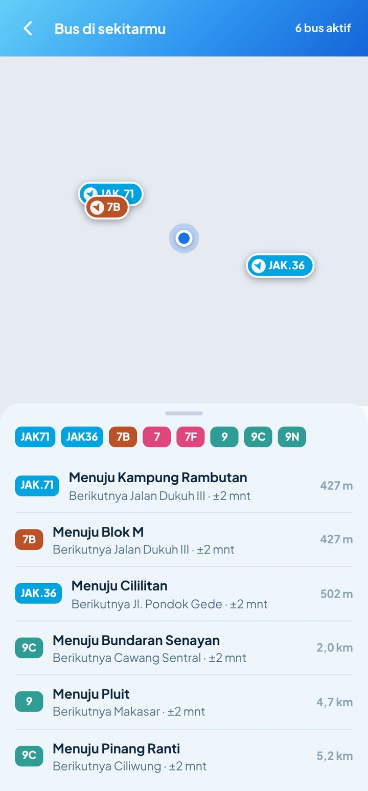
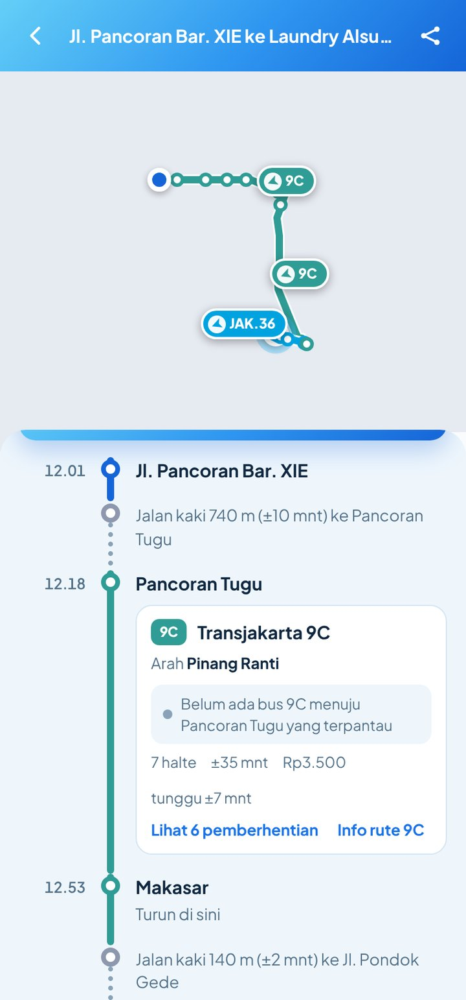

<div align="center">


# ✦ Lumi Transportation ✦

### Perencana perjalanan semua moda Jabodetabek untuk Android

*Transjakarta · Mikrotrans · KRL · MRT · LRT · KA Bandara · Whoosh · ojol, dalam satu rute*

[](https://github.com/vickyvam72/LumiTransportation/releases/latest)
[](#-kebutuhan-sistem)
[](#%EF%B8%8F-teknologi)
[](LICENSE)
[](#-kenapa-lumi-transportation)

**🌐 Bahasa / Language:** &nbsp; **🇮🇩 Bahasa Indonesia** &nbsp;|&nbsp; [🇬🇧 English](README.en.md)

[⬇️ Unduh](#%EF%B8%8F-unduh--pasang) · [📸 Tampilan](#-tampilan) · [✨ Fitur](#-fitur) · [💸 Tarif](#-tarif-yang-dipakai) · [📖 Panduan](#-panduan-pemakaian) · [❓ FAQ](#-faq--mengatasi-masalah) · [📝 Catatan Perubahan](CHANGELOG.md)

</div>

---

## 🌟 Kenapa Lumi Transportation?

> Masukkan **asal** dan **tujuan**, lalu Lumi menghitung **semua kombinasi angkutan umum** yang masuk akal (bus, mikrotrans, kereta, sampai ojol), lengkap dengan **waktu, tarif, dan tempat turun**. Saat berangkat, Lumi **mendampingimu lewat GPS** dan mengingatkan saat harus turun.

| | |
|---|---|
| 🗺️ **Semua kombinasi rute** | 9 dan 9A muncul sebagai opsi sendiri, begitu juga JAK36 → LRT, 9C → Makasar → JAK108, dan lainnya. Bukan cuma satu jawaban. |
| 🎯 **Filter yang kamu mau** | Urutkan Tercepat, Termurah, atau Minim transit, lalu pilih moda: hanya yang **mengandung TJ**, atau TJ + LRT, dan seterusnya. |
| 📡 **Posisi bus langsung** | Lihat bus Transjakarta, Mikrotrans, dan Royaltrans **bergerak di peta**, ke mana tujuannya, dan **kapan tiba di haltemu**, seperti di aplikasi TJ. |
| 🧭 **Pendampingan GPS** | Tahu posisimu di peta, **sisa pemberhentian**, dan HP bergetar saat **"Siap-siap turun"** dan **"Turun sekarang"**, juga saat layar mati. |
| 🔔 **Tahu kalau rute berubah** | Data resmi Transjakarta **dicek tiap jam**. Begitu ada rute baru, rute dihapus, atau halte berubah, kamu dapat **notifikasi**. |
| 🖼️ **Bagikan sebagai gambar** | Setiap rute bisa dibagikan sebagai **gambar rapi** ke WhatsApp, IG, atau mana saja. |
| 💸 **Tarif yang benar** | Pindah di dalam halte = tidak bayar lagi. Turun di luar halte = tap ulang. Termasuk tarif SH2, Hub Connector, MRT per stasiun, KA Bandara. |
| 🌙 **Sadar jam operasional** | Pukul 00.00? Lumi hanya memakai layanan 24 jam (AMARI koridor 1–14, JAK36/47/52/75) dan ojol. |
| 📍 **Alamat dari Google Maps** | Cari tempat di Google Maps, ketuk **Bagikan → Lumi**. Koordinat tempat terbaca otomatis. |
| 🪶 **Super ringan & offline** | APK sekitar **350 KB**. Perhitungan rute berjalan **di HP**, tanpa server. |

---

## 📸 Tampilan

<div align="center">

| 👋 Sambutan | ✅ Satu langkah lagi | 🏠 Beranda |
|:-:|:-:|:-:|
|  |  |  |
| **Kenalan dalam satu layar.** Tanpa scroll, langsung tahu apa yang bisa dilakukan Lumi. | **Izin yang benar-benar perlu.** Lokasi, notifikasi, dan berjalan di latar belakang, plus bantuan "Mulai otomatis" untuk HP Xiaomi, Oppo, Vivo, Realme, Infinix. | **Info rute berubah langsung di depan.** Rute baru, dihapus, atau halte berubah, tinggal ketuk untuk melihat rutenya. |

| 🗺️ Semua opsi | 🎯 Filter moda & urutan | 🧭 Pendampingan GPS |
|:-:|:-:|:-:|
|  |  |  |
| **Bandingkan dalam sekali lihat.** Strip warna per jalur, waktu, tarif, jumlah pindah, dan tombol **Bagikan rute** di tiap kartu. | **Hanya yang ada TJ-nya, urut termurah.** Atau TJ + LRT, Mikrotrans, KRL, MRT, Ojol. | **Tidak kebablasan lagi.** "Siap-siap turun!" saat tinggal satu pemberhentian, lengkap dengan getar. |

| 📡 Bus di sekitarmu | 🚏 Bus berikutnya di halte naik | 🧭 Arah & varian yang jelas |
|:-:|:-:|:-:|
|  |  |  |
| **Posisi bus langsung** di sekitarmu, lengkap dengan tujuan, halte berikutnya, dan jaraknya darimu. | **"Bus 9C berikutnya tiba di Pancoran Tugu ±4 mnt"**, langsung di kartu rute, plus posisinya di peta. | **9N: Pinang Ranti – Simpang Cawang**, dua arah yang jelas, dan setiap varian diberi keterangan (via Tol, lewat Senen, …). |

| 🖼️ Bagikan sebagai gambar | 💸 Tarif terbaru |
|:-:|:-:|
|  |  |
| **Kirim rute ke teman atau keluarga** sebagai gambar: jam naik, arah, tempat turun, dan tarif per moda; langkah jalan kaki bertanda ikon orang berjalan. | **Tarif per Oktober 2026**, termasuk SH2 Rp15.000 dan Hub Connector Rp20.000. |

</div>

---

## ✨ Fitur

**🗺️ Perencana rute**
- Mesin rute **offline** (graf + Dijkstra) ditambah penjelajahan sistematis **semua rute langsung dan semua kombinasi dua rute**, sehingga opsi seperti 9/9C → Makasar → JAK36/JAK108 dan LRT → TMII → JAK36 ikut muncul
- **Varian rute dengan kode sama** dibedakan, mis. koridor 9 arah Pluit **via Tol** yang tidak berhenti di Kemanggisan s.d. Jembatan Dua
- Rute memutar (mis. JAK36 Cilangkap → Cililitan → Cilangkap) ditangani dengan benar: naik dan turun di sisi jalan yang tepat, dan **tidak ikut bus memutar** demi jalan kaki lebih pendek (turun di Ps. Hek 1, bukan Ps. Hek 2)
- Opsi ganda dibuang otomatis, opsi "naik satu halte lalu jalan" yang tidak menguntungkan juga dibuang
- **Jam berangkat / tiba sebelum**, dengan jam operasional tiap moda (AMARI 24 jam, Mikrotrans 24 jam, KRL, MRT, LRT, KA Bandara, Whoosh)
- Kombinasi **ojol + kereta** dan ojol motor/mobil langsung, dengan jarak jalan dari OSRM

**📡 Posisi bus langsung**
- **Bus di sekitarmu** (di Beranda): peta dengan bus Transjakarta, Mikrotrans, dan Royaltrans dari rute yang melintas dalam ±900 m, diperbarui tiap beberapa detik; ketuk bus untuk melihat tujuan, halte berikutnya, dan kepadatan
- **Detail rute**: semua bus rute itu di peta, yang searah dengan arah pilihanmu tampil paling atas
- **Detail perjalanan**: *"Bus 9C berikutnya tiba di Pancoran Tugu ±4 mnt"* untuk setiap ruas bus, hanya menghitung bus yang memang menuju halte turunmu
- Hemat kuota: Lumi hanya berlangganan rute yang sedang kamu lihat, dan berhenti saat layar ditutup
- Bila data armada tidak bisa dijangkau, Lumi menampilkan penyebabnya dan tombol **Lihat di aplikasi TJ**

**🎯 Filter hasil**
- Urutan: **Rekomendasi · Tercepat · Termurah · Minim transit**
- Moda: **Transjakarta · Mikrotrans · LRT · MRT · KRL · Royaltrans · KA Bandara · Whoosh · Ojol**. Yang tampil adalah opsi yang **mengandung semua moda terpilih**, boleh dikombinasi moda lain

**🧭 Mode pendampingan**
- Ketuk **Mulai pendampingan** di detail rute
- GPS dibaca terus lewat **layanan latar depan**, tetap berjalan saat layar mati atau aplikasi di belakang
- Notifikasi berjalan: *"JAK36 · 2 pemberhentian lagi · turun di UP Angkutan Sekolah"*
- Peringatan dengan getar: **Siap-siap turun** (tinggal 1 pemberhentian) dan **Turun sekarang** (plus rute lanjutan)
- Posisi tampil di peta perjalanan, dan langkah yang sedang dijalani ditandai **"Kamu di sini"**

**🔔 Rute selalu terbaru**
- Saat pertama dibuka, Lumi mengunduh **GTFS resmi Transjakarta** dan memprosesnya di HP
- **Tiap jam** (latar belakang, sangat hemat kuota) Lumi mengecek:
  1. umpan perubahan rute dari repo ini (`data/route_changes.json`), yang diperbarui GitHub Actions tiap jam, dan
  2. tanda versi file GTFS resmi (ETag / Last-Modified / ukuran)
- Bila ada yang berubah, data rute diunduh ulang, perbedaannya dihitung (rute baru, dihapus, halte bertambah/berkurang, pola varian berubah), lalu muncul **notifikasi**
- Riwayat perubahan ada di Beranda dan **Pengaturan → Perubahan rute**

**🖼️ Bagikan rute sebagai gambar**
- Tombol **Bagikan rute** di setiap kartu hasil dan di detail perjalanan
- Gambar PNG berisi asal → tujuan, total waktu & tarif, strip moda, serta langkah per langkah (jam naik, arah, tempat turun, tarif)

**📍 Alamat lewat Google Maps**
- Ketuk kolom Dari/Ke → **Cari di Google Maps** → pilih tempat → **Bagikan → Lumi Transportation**
- Koordinat **tempat** dibaca dari tautan (bukan posisi peta), dengan tiga cara berjalan bersamaan dan hasil disimpan di HP agar instan saat dipakai lagi
- **Tempat tersimpan**, **Lokasi saya**, dan pilih titik di peta

**🎨 Tampilan**
- Tema **biru muda** dengan logo gradasi biru, layar sambutan dan izin yang **muat satu layar**
- Info rute lengkap: cari rute (`9`, `13C`, `JAK.10`, `Bogor`, `MRT`), lihat urutan halte, arah, varian, jam operasional, dan rute sambungan di tiap halte
- Nama trayek resmi (mis. **9N Pinang Ranti – Simpang Cawang**). Rute memutar dipecah menjadi dua arah, dan setiap varian diberi keterangan singkat: *via Tol*, *lewat Senen*, *tanpa ASEAN*, *mulai Bundaran Senayan*, *putar balik di Harmoni*
- Peta **CARTO Basemaps** (bisa pakai API key sendiri di Pengaturan)

---

## 💸 Tarif yang dipakai

Diperbarui **29 Oktober 2026**. Tarif adalah perkiraan; selalu cek pengumuman operator.

| Moda | Tarif |
|---|---|
| Transjakarta BRT, non-BRT, Transjabodetabek (T31, P11, SH1, …) | **Rp3.500** (Rp2.000 pukul 05.00–07.00) |
| Pindah rute tanpa keluar halte | Gratis |
| Turun di luar halte lalu naik lagi | Bayar lagi (tap ulang) |
| SH2 Blok M – Bandara Soetta (sejak 1 Sep 2026) | Rp15.000 |
| Hub Connector HC2 PIK 2 – Dukuh Atas | Rp20.000 |
| Royaltrans | Rp20.000 |
| Mikrotrans (JakLingko) | Gratis |
| KRL Commuter Line | Rp3.000 (25 km pertama) + Rp1.000 / 10 km |
| MRT Jakarta | Rp3.000 + Rp1.000 per stasiun, maks. Rp14.000 |
| LRT Jakarta (termasuk Velodrome – Manggarai) | Rp5.000 flat |
| LRT Jabodebek, jam sibuk (Sen–Jum 06.00–08.59 & 16.00–19.59) | Rp5.000 + Rp700/km, maks. Rp20.000 |
| LRT Jabodebek, di luar jam sibuk, Sabtu, Minggu & libur | maks. Rp10.000 |
| KA Bandara Manggarai / BNI City / Duri – Soetta | Rp70.000 (Rawa Buaya / Batu Ceper Rp35.000) |
| Whoosh | mulai Rp250.000 (tarif dinamis) |
| Ojol motor (zona Jabodetabek) | Rp2.550–2.800/km, minimum Rp10.200–11.200 + biaya aplikasi |

> ℹ️ Pemprov DKI mengumumkan **penyesuaian tarif Transjakarta mulai 1 Januari 2027**, besarannya belum diumumkan. Tarif baru LRT Jakarta juga disebut akan segera ditetapkan.

<details>
<summary><b>Sumber tarif</b></summary>

- [Tarif Transjabodetabek Blok M–Bandara Soetta Rp15.000 mulai 1 September 2026 (CNA)](https://www.cna.id/indonesia/transjabodetabek-blok-m-bandara-tarif-49386)
- [Tarif TransJ dan Transjabodetabek akan naik, diberlakukan 1 Januari 2027 (detik)](https://news.detik.com/berita/d-8684573/tarif-transj-dan-transjabodetabek-akan-naik-diberlakukan-1-januari-2027)
- [Transjakarta Dukuh Atas–PIK 2 beroperasi mulai 3 Agustus, tiket Rp20.000 (Bisnis)](https://ekonomi.bisnis.com/read/20260730/98/1992270/transjakarta-dukuh-atas-pik-2-beroperasi-mulai-3-agustus-tiket-rp20000)
- [Tarif bus Royaltrans dipastikan tak naik, tetap Rp20.000 (Merdeka)](https://www.merdeka.com/jakarta/read/8141114/tarif-bus-royaltrans-dipastikan-tak-naik-tetap-rp20000)
- [LRT Velodrome–Manggarai diresmikan, tarif flat Rp5.000 (CNN Indonesia)](https://www.cnnindonesia.com/nasional/20260826062444-20-1396280/lrt-velodrome-manggarai-diresmikan-hari-ini-tarif-flat-rp5000)
- [Tarif KRL dipastikan tidak naik (detik)](https://finance.detik.com/infrastruktur/d-8549190/tarif-krl-dipastikan-tidak-naik)
- [Daftar tarif MRT Jakarta tiap stasiun 2026](https://jadwalkeretaapi.com/tarif-mrt-jakarta-daftar-stasiun-mrt-jakarta/)
- [Cara naik LRT Jabodebek: tarif jam sibuk & di luar jam sibuk (Dealls)](https://dealls.com/pengembangan-karir/cara-naik-lrt)
- [Rute LRT Jabodebek 2026: stasiun, tarif (Jendela360)](https://jendela360.com/info/rute-lrt-jabodebek-2026-ra0526/)
- [Jadwal & harga kereta Bandara Soekarno-Hatta (Dealls)](https://dealls.com/pengembangan-karir/jadwal-kereta-bandara)
- [Whoosh terapkan tarif dinamis, mulai Rp250.000 (Kompas)](https://money.kompas.com/read/2026/06/14/191200526/whoosh-terapkan-tarif-dinamis-saat-libur-sekolah-harga-tiket-mulai-rp-250.000)
- [Perpres ojol terbit: potongan 8%, tarif diatur Kemenhub (CNN Indonesia)](https://www.cnnindonesia.com/otomotif/20261009100050-579-1413414/perpres-ojol-terbit-tegaskan-potongan-8-dan-tarif-diatur-kemenhub)

</details>

---

## ⬇️ Unduh & Pasang

1. Buka halaman **[Releases](https://github.com/vickyvam72/LumiTransportation/releases/latest)**.
2. Di bagian **Assets**, unduh `LumiTransportation-v2.3.apk`.
3. Buka file yang sudah diunduh. Kalau Android meminta, izinkan **"Instal aplikasi tidak dikenal"** untuk browser atau pengelola file yang kamu pakai.
4. Tekan **Instal**. Selesai! 🎉

> 💡 **Update:** Cukup pasang APK baru di atas yang lama. Tempat tersimpan dan pengaturanmu tetap aman.

### 📋 Kebutuhan Sistem
- Android **7.0 (API 24)** atau lebih baru
- Ruang kosong sekitar **10 MB** (data rute resmi disimpan di HP)
- Internet untuk peta, membaca tautan Google Maps, dan cek perubahan rute (perhitungan rute sendiri offline)
- Aplikasi **Google Maps** untuk mencari alamat (disarankan)

---

## 📖 Panduan Pemakaian

### 0️⃣ Pertama kali dibuka
Lumi menampilkan dua layar singkat, masing-masing **pas dalam satu layar tanpa scroll**:
1. **Sambutan**: ringkasan fitur, ketuk **Mulai**.
2. **Satu langkah lagi**: izinkan **lokasi**, **notifikasi**, dan **berjalan di latar belakang**. Untuk HP Xiaomi, Oppo, Vivo, Realme, dan Infinix ada tombol opsional **Buka pengaturan Mulai otomatis**.

Setelah itu Lumi mengunduh data rute resmi Transjakarta di latar belakang (butuh internet sekali).

### 1️⃣ Isi asal & tujuan
Ketuk **Dari** atau **Ke** → **Cari di Google Maps** → pilih tempatnya → **Bagikan** → **Lumi Transportation**. Kolom terisi otomatis dan tempat itu tersimpan. Bisa juga **Lokasi saya** atau tempat tersimpan.

### 2️⃣ Pilih jam & cari rute
Ketuk jam untuk **Berangkat jam** atau **Tiba sebelum**, lalu **Cari rute**.

### 3️⃣ Saring hasil
Ketuk **Tercepat / Termurah / Minim transit**, lalu pilih moda di baris **Moda**. Contoh: pilih **Transjakarta** untuk melihat semua opsi yang memakai TJ (termasuk TJ + LRT). Ketuk **Tampilkan semua** untuk opsi lainnya.

### 4️⃣ Mulai pendampingan 🧭
Buka salah satu rute → **Mulai pendampingan**. Kartu biru di bawah layar dan notifikasi menunjukkan langkah berikutnya dan sisa pemberhentian. Ketuk **Berhenti** untuk mengakhiri.

### 5️⃣ Bagikan rute 🖼️
Ketuk **Bagikan rute** di kartu hasil atau di detail perjalanan, lalu pilih WhatsApp atau aplikasi lain. Yang terkirim adalah **gambar rute**.

### 6️⃣ Lihat perubahan rute 🔔
Saat ada perubahan, notifikasi muncul. Ketuk untuk melihat daftarnya, atau buka **Pengaturan → Perubahan rute**. Tombol **Lihat rute** membuka halte terbaru rute itu.

### 7️⃣ Lihat bus secara langsung 📡
Di Beranda ketuk **Bus di sekitarmu**. Di detail perjalanan, kartu tiap bus menunjukkan kapan bus berikutnya tiba di halte naikmu. Di tab **Rute**, buka rute mana pun untuk melihat semua busnya di peta.

### 8️⃣ Info rute
Tab **Rute**: cari kode atau nama rute, pilih arah/varian, ketuk halte untuk menjadikannya asal atau tujuan.

---

## ❓ FAQ & Mengatasi Masalah

<details>
<summary><b>Notifikasi pendampingan atau perubahan rute tidak muncul</b></summary>

Pastikan izin notifikasi aktif dan **Berjalan di latar belakang** sudah diizinkan (Pengaturan HP → Aplikasi → Lumi Transportation → Baterai → Tidak dibatasi). Di HP Xiaomi, Oppo, Vivo, Realme, dan Infinix aktifkan juga **Mulai otomatis**.
</details>

<details>
<summary><b>Seberapa cepat Lumi tahu ada rute berubah?</b></summary>

Paling lama sekitar **1 jam** setelah Transjakarta memperbarui data GTFS resminya. GitHub Actions di repo ini mengecek GTFS tiap jam, dan aplikasi juga mengecek sendiri tanda versi file GTFS tiap jam. Perubahan yang hanya diumumkan di media sosial (mis. pengalihan sementara) baru tercatat setelah masuk ke data resmi.
</details>

<details>
<summary><b>Lokasi dari Google Maps meleset</b></summary>

Bagikan **tempatnya** (ketuk nama tempat → Bagikan), bukan tampilan peta. Bila koordinat tetap tidak terbaca, Lumi membuka peta agar kamu bisa menggeser pin.
</details>

<details>
<summary><b>Kenapa ada rute tanpa daftar halte?</b></summary>

Rute itu ada di daftar resmi tetapi data haltenya belum terunduh. Buka **Pengaturan → Perbarui lagi** saat ada internet.
</details>

<details>
<summary><b>Tarif di Lumi beda dengan yang saya bayar</b></summary>

Tarif adalah perkiraan berdasarkan aturan yang diumumkan (lihat [Tarif yang dipakai](#-tarif-yang-dipakai)). Promo, tarif khusus hari libur, dan harga ojol saat jam sibuk bisa berbeda.
</details>

---

## 🔒 Privasi

- ✅ **Tanpa** iklan, analitik, atau pelacak
- ✅ Lokasi dan tempat tersimpan hanya ada **di HP-mu**
- ✅ Rute dihitung di HP; tidak ada server Lumi
- ℹ️ Internet dipakai untuk: peta CARTO, membaca tautan Google Maps, jarak jalan OSRM (estimasi ojol), GTFS resmi Transjakarta, umpan perubahan rute dari GitHub, dan feed posisi armada Transjakarta (hanya saat fitur bus langsung dibuka; Lumi tidak mengirim lokasimu ke sana)

---

## 🛠️ Teknologi

| Bagian | Teknologi |
|---|---|
| Aplikasi | **Java** (Android SDK, tanpa library tambahan) + **WebView** |
| Antarmuka | HTML, CSS, JavaScript murni, font Plus Jakarta Sans |
| Peta | **Leaflet** + CARTO Basemaps (OpenStreetMap) |
| Mesin rute | Graf multimoda + Dijkstra + enumerasi kombinasi (`engine.js`), berjalan offline |
| Data rute | GTFS resmi Transjakarta (diproses di HP oleh `GtfsImporter.java`) |
| Bus langsung | WebSocket native (`LiveSocket.java`) + klien MQTT 3.1.1 mini (`live.js`), tanpa library tambahan |
| Latar belakang | Foreground service (pendampingan GPS), JobScheduler (cek rute tiap jam & harian) |
| CI/CD | GitHub Actions: build APK tiap push & pantau perubahan rute tiap jam |

### 📁 Struktur proyek
```
app/src/main/
├── AndroidManifest.xml
├── java/id/lumi/transport/
│   ├── MainActivity.java     # WebView + jembatan native (lokasi, berbagi gambar, izin, Google Maps)
│   ├── NavService.java       # Pendampingan GPS (foreground service + notifikasi)
│   ├── GuideTracker.java     # Logika posisi pada rute: sisa pemberhentian, siap-siap turun
│   ├── GtfsImporter.java     # Unduh & ringkas GTFS resmi di HP
│   ├── RouteUpdater.java     # Perbarui data rute + catat perubahan
│   ├── RouteDiff.java        # Bandingkan rute lama vs baru
│   ├── RouteWatchJob.java    # Cek perubahan tiap jam
│   ├── RouteUpdateJob.java   # Pembaruan harian
│   └── ShareProvider.java    # Berbagi gambar rute tanpa izin penyimpanan
└── assets/www/
    ├── index.html, css/app.css
    ├── js/engine.js          # Mesin rute, tarif, jam operasional
    ├── js/app.js             # Antarmuka
    ├── js/live.js            # Klien MQTT mini untuk posisi bus langsung
    └── js/data.js            # Data rute bawaan (dibuat tools/build_data.py)
data/                         # Umpan perubahan rute (diisi GitHub Actions)
data-raw/                     # Data mentah: GTFS, koordinat stasiun, daftar rute resmi
tools/
├── build_data.py             # data-raw → data.js
├── route_watch.py            # Pemantau perubahan rute (GitHub Actions)
├── test_engine.js            # Uji mesin rute
└── zipalign.py
build.sh                      # Build APK tanpa Gradle
```

### 🏗️ Build dari kode sumber
Lumi dibangun **tanpa Gradle** memakai `aapt2`, `ecj`, `d8`, dan `apksigner`:

```bash
git clone https://github.com/vickyvam72/LumiTransportation.git
cd LumiTransportation
# isi variabel berikut (atau taruh file-nya di tools/sdk/)
export ANDROID_JAR=$ANDROID_HOME/platforms/android-34/android.jar
export AAPT2=$ANDROID_HOME/build-tools/34.0.0/aapt2
export D8_JAR=$ANDROID_HOME/build-tools/34.0.0/lib/d8.jar
export APKSIGNER_JAR=$ANDROID_HOME/build-tools/34.0.0/lib/apksigner.jar
export ECJ_JAR=/path/ke/ecj.jar          # org.eclipse.jdt:ecj
./build.sh                                # hasil: build/LumiTransportation.apk
node tools/test_engine.js                 # uji mesin rute
```
Folder ini juga punya `build.gradle` bila ingin membuka di Android Studio.

> 🔐 Build rilis ditandatangani dengan kunci yang disimpan di **GitHub Actions Secrets** (`LUMI_KEYSTORE_BASE64`, `LUMI_KEYSTORE_PASSWORD`, opsional `LUMI_KEY_ALIAS`). Kunci tidak pernah disimpan di repo. Tanpa secrets, workflow tetap mem-build APK (sebagai artifact) tetapi tidak menerbitkan rilis.

### 🔔 Pemantau perubahan rute
Workflow [`route-watch.yml`](.github/workflows/route-watch.yml) berjalan tiap jam: mengunduh GTFS resmi, membandingkan ringkasan rute dengan `data/route_index.txt`, lalu menulis `data/route_changes.json` bila ada perubahan. Aplikasi membaca file kecil ini tiap jam lewat `raw.githubusercontent.com`.

---

## 🙏 Terima Kasih

Lumi Transportation bisa berdiri berkat data terbuka, proyek open-source, dan layanan berikut. **Terima kasih banyak** untuk para pembuat dan kontributornya! 💖

### 🚌 Data transportasi
| Sumber | Yang dipakai Lumi |
|---|---|
| [**Transjakarta**](https://transjakarta.co.id/rute) | GTFS resmi ([gtfs.transjakarta.co.id](https://gtfs.transjakarta.co.id)) dan daftar rute resmi |
| [**altilunium/BRT-tj**](https://github.com/altilunium/BRT-tj) | Salinan GTFS resmi BRT Transjakarta (Jan 2024) untuk data bawaan |
| [**akherlan/transjakartagtfs**](https://github.com/akherlan/transjakartagtfs) | GTFS Transjakarta 2021 untuk rute non-BRT, Mikrotrans, Royaltrans bawaan |
| [**Rebornian48/map-visualizer**](https://github.com/Rebornian48/map-visualizer) | Koordinat stasiun kereta (data sarana prasarana Kemenhub) |
| [**MobilityData**](https://mobilitydatabase.org/feeds/gtfs/mdb-1909) | Katalog feed GTFS Transjakarta |
| [**BroNils/open-tj**](https://github.com/BroNils/open-tj) | Dokumentasi feed armada Transjakarta (broker MQTT, struktur topik, dan isi pesan) |
| [**stoikal/tj-tracker**](https://github.com/stoikal/tj-tracker) | Contoh pelacak bus TJ langsung dengan feed armada yang sama |
| KAI Commuter, MRT Jakarta, LRT Jakarta, LRT Jabodebek, KAI Bandara, KCIC | Urutan stasiun, jam operasional, dan tarif dari situs serta pengumuman resmi |
| Wikipedia & media (Kompas, detik, CNA, Bisnis, CNN Indonesia, Suara, IDN Times, dll.) | Perubahan rute (mis. koridor 9 via tol), tarif terbaru, dan jam operasional |

### 🗺️ Peta & lokasi
[OpenStreetMap](https://www.openstreetmap.org/copyright) contributors · [CARTO Basemaps](https://carto.com/basemaps) · [OSRM](https://project-osrm.org/) (jarak jalan untuk estimasi ojol) · [Google Maps](https://maps.google.com) (pencarian alamat lewat fitur Bagikan)

### 📚 Library & aset
[Leaflet](https://github.com/Leaflet/Leaflet) oleh Volodymyr Agafonkin dkk. · [Plus Jakarta Sans](https://github.com/tokotype/PlusJakartaSans) oleh Tokotype (SIL OFL) · [Eclipse JDT ecj](https://github.com/eclipse-jdt/eclipse.jdt.core) · Android build tools (aapt2, d8, apksigner)

> Proyek, data, dan layanan di atas tidak berafiliasi dengan Lumi Transportation. Seluruh penghargaan atas karya mereka menjadi milik pembuatnya masing-masing.

---

## ⚖️ Penafian

Lumi Transportation adalah proyek independen untuk **penggunaan pribadi dan edukasi**.
Lumi **tidak berafiliasi dengan, didukung oleh, atau disponsori oleh** PT Transportasi Jakarta, PT KAI / KAI Commuter, PT MRT Jakarta, PT LRT Jakarta, KCIC, Gojek, Grab, maupun Google. Semua merek dagang adalah milik pemiliknya masing-masing.
Waktu tempuh dan tarif adalah **perkiraan**. Posisi bus langsung berasal dari feed armada publik Transjakarta yang tidak terdokumentasi resmi, sehingga bisa terlambat, tidak lengkap, atau berhenti sewaktu-waktu. Selalu cek pengumuman operator untuk gangguan atau perubahan layanan.

## 📄 Lisensi

Hak cipta © 2026 **vickyvam72**.

Lumi Transportation adalah perangkat lunak bebas dan open source, dirilis di bawah **[GNU General Public License v3.0](LICENSE)**.
Kamu boleh memakai, mempelajari, mengubah, dan membagikan ulang Lumi Transportation, dengan syarat versi turunannya juga dirilis dengan lisensi yang sama (GPL-3.0) dan kode sumbernya tetap terbuka.
Leaflet (BSD-2-Clause) dan Plus Jakarta Sans (SIL OFL 1.1) tetap memakai lisensi masing-masing.
Lumi Transportation diberikan **tanpa jaminan apa pun**. Lihat file [LICENSE](LICENSE) untuk teks lengkapnya (berbahasa Inggris).

<div align="center">

---

Dibuat dengan ❤️ di Jakarta · Kalau Lumi membantu perjalananmu, beri ⭐ ya

</div>
